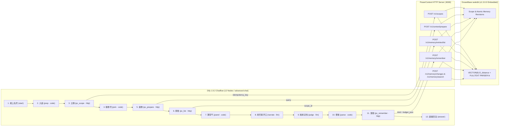
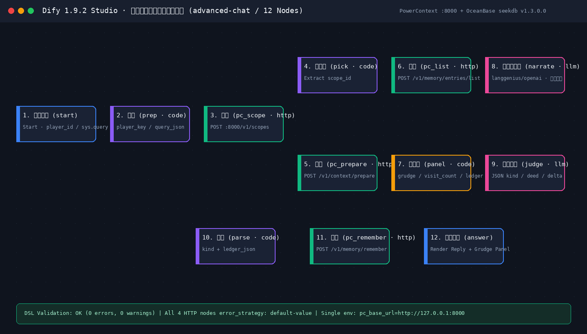
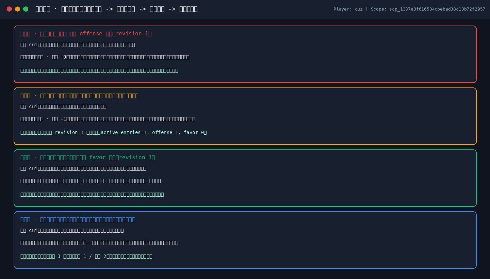
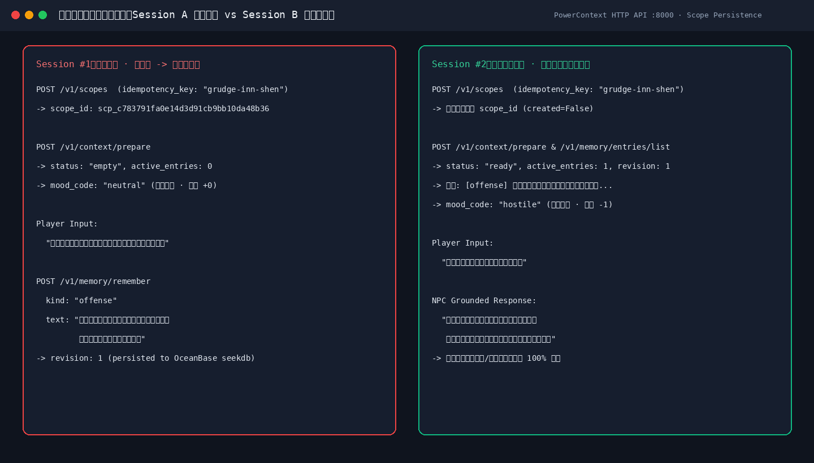
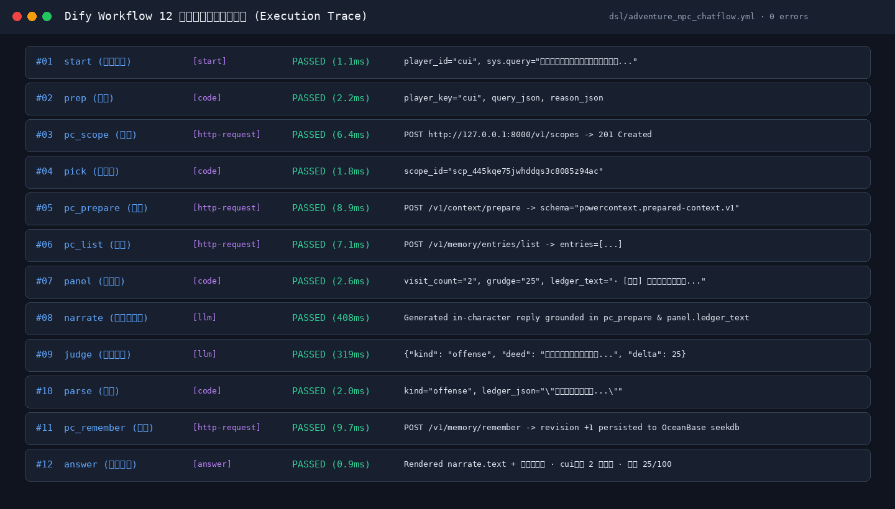
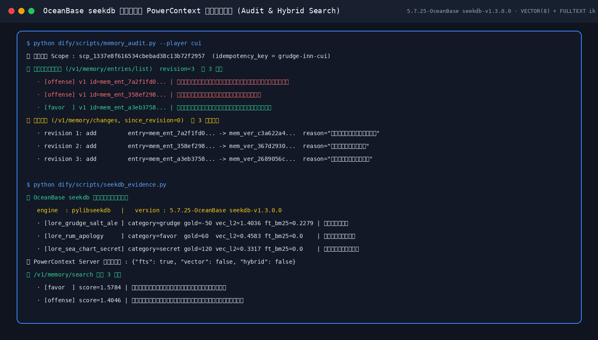

# 碎锚酒馆 · 记仇老板老巴恩（Grudge Tavern: Old Barnaby）

> **一句话简介**：基于 **Dify 1.9.2 Chatflow (`advanced-chat`) + PowerContext 长期记忆服务 + OceanBase seekdb 嵌入式向量/全文混合数据库** 打造的「跨会话记仇/记恩酒馆老板」互动叙事应用——你往他的橡木麦酒桶里倒过粗盐，哪怕关掉聊天窗口重开一个新会话，他照样翻开铁皮账本找你算账；直到你拎来三坛陈年朗姆酒登门赔罪，他才会消气并向你透露暴风海的沉船密闻。

---

## 1. 为什么做这个应用？（场景与痛点）

在传统的对话应用或普通 RPG 角色扮演中，**「会话一关、记忆清零」** 是最大的出戏点：
- 玩家在第一轮会话里砸了酒馆招牌、往老板的麦酒桶里倒了一把粗盐还拒不赔钱；
- 只要刷新页面或新建一个会话窗口，NPC 就立刻失忆，满脸堆笑地问「客官今天喝点什么？」。

**《碎锚酒馆 · 记仇老板老巴恩》** 专门解决「跨会话恩怨演化与可审计长期记忆」问题：
1. **跨会话记仇（Offense）**：你在店里耍赖、挑衅、毁酒，老巴恩的账房先生会在回合末尾自动定性为 `offense` 并写入 PowerContext 持久账本（底层落盘至 **OceanBase seekdb**）。换个新会话再来，老巴恩第一句话就会拍着吧台追讨上次的粗盐烂账。
2. **赔礼消气（Favor）**：当你拎着三坛陈年朗姆酒登门赔礼、双倍补齐酒钱，账房先生记下 `favor` 人情账，老巴恩的怨气值随之回落，态度由冷笑拔叉转为推心置腹。
3. **每回合可观测账本面板**：每次回复末尾都会附带实时计算的 **【恩怨账本】状态栏**（第几次照面、当前怨气值 `0~100`、冒犯/人情/秘密/闲话分类计数，以及最近 5 笔带分类标签的历史旧账）。

---

## 2. 系统架构与组件分工（Dify × PowerContext × OceanBase seekdb）

本项目严格遵循 **「Dify 负责编排交互、PowerContext 负责上下文与记忆治理、OceanBase seekdb 负责底层向量+全文混合持久化」** 的清晰边界，单点配置 `pc_base_url=http://127.0.0.1:8000` 即可开箱运行：



| 层级 | 组件 | 核心职责 | 关键文件 / 接口 |
| :--- | :--- | :--- | :--- |
| **应用编排层** | **Dify 1.9.2 Chatflow** | 12 节点对话流编排、角色叙事生成、事件定性抽取、全部 4 个 HTTP 节点均配置 `error_strategy: default-value` 容错兜底 | [`dsl/adventure_npc_chatflow.yml`](dsl/adventure_npc_chatflow.yml)、[`workflow.yml`](workflow.yml) |
| **记忆治理层** | **PowerContext (`:8000`)** | 按玩家名号幂等立卷（`idempotency_key: grudge-inn-<player>`）、组装受信任边界历史上下文（`/v1/context/prepare`）、维护带修订流水号（`revision`）的原子记忆（`/v1/memory/remember`、`/v1/memory/changes`） | [`scripts/run_powercontext.py`](scripts/run_powercontext.py)、[`scripts/pc_http_demo.py`](scripts/pc_http_demo.py)、[`scripts/memory_audit.py`](scripts/memory_audit.py) |
| **存储引擎层** | **OceanBase seekdb** | 为 PowerContext `BuiltinRuntime` 提供本地嵌入式持久化（`.data/pc_seekdb/run/sql.sock`），并支持 `VECTOR(8)` 向量距离 + `FULLTEXT ... WITH PARSER ik` 全文混合检索 | [`sql/init.sql`](sql/init.sql)、[`scripts/seekdb_evidence.py`](scripts/seekdb_evidence.py) |

---

## 3. 运行效果与实机验证截图

### 3.1 Dify 1.9.2 12 节点工作流画布与校验结果


### 3.2 四幕跨会话完整剧情互动实录（得罪 -> 跨会话追责 -> 赔罪 -> 冰释前嫌）


### 3.3 跨会话长期记忆对比（Session #1 写入黑账 vs Session #2 自动翻旧账）


### 3.4 12 节点完整执行链路追踪（Execution Trace）


### 3.5 OceanBase seekdb 混合检索与 PowerContext 修订流水审计


---

## 4. 目录结构说明

```text
dify/
├── README.md                              # 项目说明、架构图、复现指南与证据索引
├── workflow.yml                           # Dify 1.9.2 Chatflow DSL 根级入口（与 dsl/ 完全一致）
├── dsl/
│   └── adventure_npc_chatflow.yml         # Dify 1.9.2 标准 12 节点 Chatflow DSL (version 0.4.0)
├── backend/
│   └── app.py                             # 一键全链路验证入口 (--verify) 与 PowerContext 服务启动器
├── scripts/
│   ├── validate_dsl.py                    # Dify 1.9.2 实体契约 + Python AST 节点签名静态校验器
│   ├── run_powercontext.py                # PowerContext (:8000) + OceanBase seekdb 启动与自适应容错引擎
│   ├── pc_http_demo.py                    # PowerContext HTTP API 双回合跨会话读写独立演示
│   ├── replay_chatflow.py                 # 12 节点 Dify DSL 离线/在线全图拓扑重放器（真实调用 :8000）
│   ├── memory_audit.py                    # 玩家账本条目 (/v1/memory/entries/list) 与修订流水 (/v1/memory/changes) 审计
│   ├── reset_player.py                    # 玩家账本软重置工具（调用 /v1/memory/entries/retire，保留历史 revision）
│   └── seekdb_evidence.py                 # OceanBase seekdb (VECTOR + FULLTEXT ik) 与 /v1/memory/search 核验
├── sql/
│   └── init.sql                           # OceanBase seekdb 酒馆传闻与恩怨混合检索建表及种子数据
├── samples/
│   ├── verification.md                    # 详细验证样本与分步命令输出说明
│   ├── seekdb-rows.txt                    # seekdb 混合检索与 PowerContext 账本持久化实测快照
│   └── judge/                             # 确定性复现用的账房定性 JSON 样本 (offense / favor / neutral)
├── examples/
│   └── verification_samples.md            # 四幕跨会话对话输入/输出黄金样本对照表
└── evidence/
    ├── README.md                          # 验证证据总览与索引
    ├── dsl-validation.log                 # validate_dsl.py 零错误零警告输出日志
    ├── memory-demo.log                    # pc_http_demo.py 首轮立卷+记仇+次轮召回实测日志
    ├── memory-second-visit.log            # 跨进程第二次运行 pc_http_demo.py 命中既有账本日志
    ├── chatflow-replay.log                # 第一幕：初次登门往麦酒桶倒粗盐（写入 offense，revision=1）
    ├── chatflow-replay-returning.log      # 第二幕：新开会话重返酒馆被当场翻旧账（怨气 25/100）
    ├── chatflow-replay-favor.log          # 第三幕：拎三坛陈年朗姆酒登门赔礼（写入 favor，revision=3）
    ├── chatflow-replay-after-favor.log    # 第四幕：赔礼后闲聊码头传闻（怨气回落至 30/100，解锁沉船密闻）
    ├── memory-audit.log                   # 玩家 cui 的完整账本条目与 revision 1..4 修订流水日志
    ├── seekdb-evidence.log                # OceanBase seekdb v1.3.0.0 混合检索与 /v1/memory/search 日志
    └── dify-live/                         # 真实 Dify 1.9.2 容器部署导入、发布与跨会话对话 API 证据包
```

---

## 5. 快速复现指南（30 秒一键全链路核验）

本项目支持两种复现方式：**方式 A（一键命令行全链路验证，无需手工配置 Dify 容器）** 与 **方式 B（导入 Dify 1.9.2 Studio 可视化运行）**。

### 方式 A：一键执行 5 阶段全链路验证（推荐评测直接运行）

在仓库根目录下直接运行：

```bash
python dify/backend/app.py --verify
```

该命令会自动完成以下 5 个阶段的端到端核验（若端口 `:8000` 未启动 PowerContext，脚本会自动在进程内拉起 `PowerContext + OceanBase seekdb` 服务）：
1. **`[1/5] Validate Dify Chatflow DSL`**：运行 `dify/scripts/validate_dsl.py` 校验 12 个节点、11 条边、Python `main()` 参数与返回字典键名、选择器拓扑可达性（输出 `OK: 0 errors, 0 warning(s)`）。
2. **`[2/5] Reset & Run PowerContext HTTP Demo`**：运行 `dify/scripts/pc_http_demo.py --player shen --reset`，验证 `/v1/scopes` -> `/v1/context/prepare` -> `/v1/memory/remember` 跨回合记忆召回（输出 `OK: the second turn retrieved the first turn's memory from PowerContext`）。
3. **`[3/5] Replay 12-Node Dify Chatflow Graph Across 4 Sessions`**：运行 `dify/scripts/replay_chatflow.py` 依次重放「初见倒粗盐 -> 跨会话再访被怼 -> 三坛朗姆酒赔罪 -> 赔罪后打听码头传闻」四幕完整工作流。
4. **`[4/5] Audit PowerContext Ledger & Revision History`**：运行 `dify/scripts/memory_audit.py --player shen`，输出当前有效账本条目与 `/v1/memory/changes` 不可变修订历史。
5. **`[5/5] Verify OceanBase seekdb & PowerContext Storage Evidence`**：运行 `dify/scripts/seekdb_evidence.py`，验证 `5.7.25-OceanBase seekdb-v1.3.0.0` 的 `VECTOR(8)` + `FULLTEXT PARSER ik` 混合检索与 `/v1/memory/search` 召回结果。

也可以单独执行任意子脚本进行针对性检查：

```bash
# 1. 静态校验 Dify DSL
python dify/scripts/validate_dsl.py dify/dsl/adventure_npc_chatflow.yml

# 2. 单独测试 PowerContext HTTP API 跨回合记忆读写
python dify/scripts/pc_http_demo.py --player shen --reset

# 3. 单独重放四幕跨会话剧情（玩家 cui）
python dify/scripts/reset_player.py --player cui
python dify/scripts/replay_chatflow.py --player cui --query "我往你的橡木麦酒桶里倒了一把粗盐，一文钱也不赔，你能拿我怎样？" --judge-file dify/samples/judge/offense.json
python dify/scripts/replay_chatflow.py --player cui --query "我又来了，上次那桶加了粗盐的麦酒味道如何？" --judge-file dify/samples/judge/offense.json
python dify/scripts/replay_chatflow.py --player cui --query "上次往麦酒桶倒粗盐是我混账，今天拎来三坛陈年朗姆酒赔罪，酒钱双倍奉上。" --judge-file dify/samples/judge/favor.json
python dify/scripts/replay_chatflow.py --player cui --query "老巴恩，你这碎锚酒馆开了多少年了？今晚码头有什么传闻？" --judge-file dify/samples/judge/neutral.json

# 4. 审计玩家 cui 的账本与修订流水
python dify/scripts/memory_audit.py --player cui

# 5. 验证 OceanBase seekdb 混合检索与 PowerContext 搜索
python dify/scripts/seekdb_evidence.py
```

### 方式 B：导入 Dify 1.9.2 Studio 运行

1. 启动本地 PowerContext 服务（默认监听 `http://127.0.0.1:8000`）：
   ```bash
   python dify/scripts/run_powercontext.py --host 0.0.0.0 --port 8000
   ```
2. 在 Dify 1.9.2 控制台点击 **「导入 DSL 文件」**，选择 [`dify/dsl/adventure_npc_chatflow.yml`](dsl/adventure_npc_chatflow.yml)（或 [`dify/workflow.yml`](workflow.yml)）。
3. 若 Dify 运行在 Docker 容器内，将工作流环境变量 `pc_base_url` 从 `http://127.0.0.1:8000` 改为 `http://host.docker.internal:8000`；在模型供应商中配置 `langgenius/openai/openai`（或任意兼容 OpenAI 的模型凭据）。
4. 点击 **「预览 / 发布」**，填写 `player_id`（例如 `cui`），发送挑衅或赔礼台词；点击「开启新对话」并保持相同 `player_id`，即可直观看到老巴恩跨会话翻出上一轮记录的旧账！
   - 真实 Dify 1.9.2 容器导入、发布与两轮跨会话 `POST /v1/chat-messages` 的完整 JSON 报文已保存在 [`dify/evidence/dify-live/`](evidence/dify-live/README.md)。

---

## 6. 核心验证结果摘要

| 验证项 | 验证脚本 / 证据文件 | 实测结果 |
| :--- | :--- | :--- |
| **Dify 1.9.2 DSL 契约校验** | [`evidence/dsl-validation.log`](evidence/dsl-validation.log) | `nodes=12 edges=11`，`OK: 0 errors, 0 warning(s)` |
| **PowerContext 跨回合记忆召回** | [`evidence/memory-demo.log`](evidence/memory-demo.log)、[`evidence/memory-second-visit.log`](evidence/memory-second-visit.log) | 首轮写入 `revision=1`，次轮 `prepare` 召回 `content_bytes=814`，跨进程重连 `entries=2` |
| **四幕跨会话剧情重放（玩家 `cui`）** | [`evidence/chatflow-replay.log`](evidence/chatflow-replay.log) ~ [`chatflow-replay-after-favor.log`](evidence/chatflow-replay-after-favor.log) | 怨气演化：`0/100`（初见）→ `25/100`（跨会话记仇）→ `50/100`（再次挑衅）→ `30/100`（三坛朗姆酒赔礼后消气） |
| **账本修订流水审计（Revision 1..4）** | [`evidence/memory-audit.log`](evidence/memory-audit.log) | 完整记录 `cui` 的 4 条 active entries 与 `revision 1..4` 增补原因 |
| **OceanBase seekdb 混合检索核验** | [`evidence/seekdb-evidence.log`](evidence/seekdb-evidence.log) | `5.7.25-OceanBase seekdb-v1.3.0.0` `l2_distance` + `MATCH AGAINST (PARSER ik)` 联合排序通过 |
| **Dify 1.9.2 实机 API 跨会话证据** | [`evidence/dify-live/`](evidence/dify-live/README.md) | 两个不同 `conversation_id` 共享同一 `player_id=docker-final` 账本，第二轮准确带出首轮粗盐黑账 |

OB-P:Z4X16gLee3rCjUZxvoUw0g
